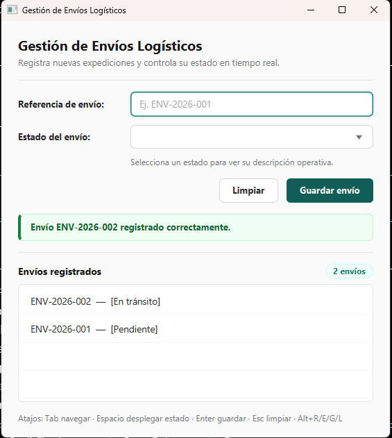
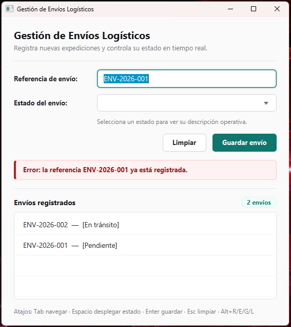
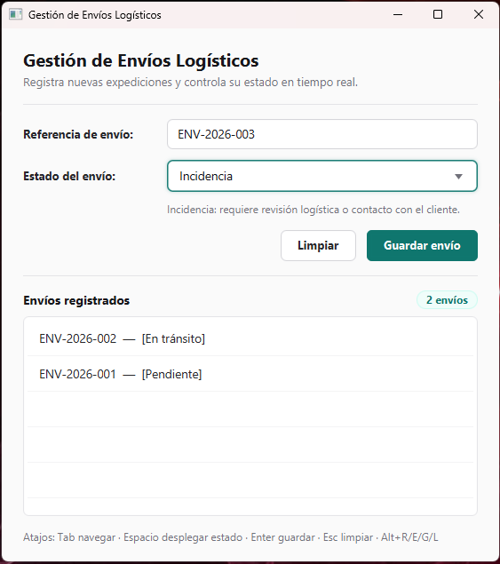
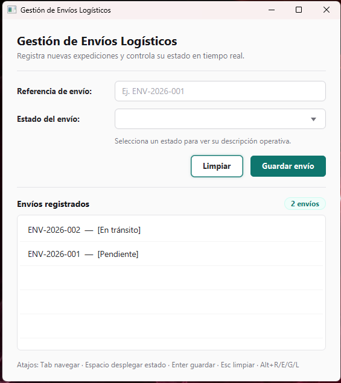
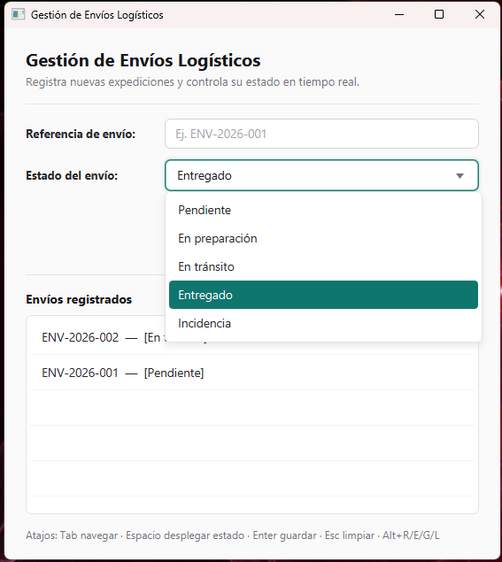
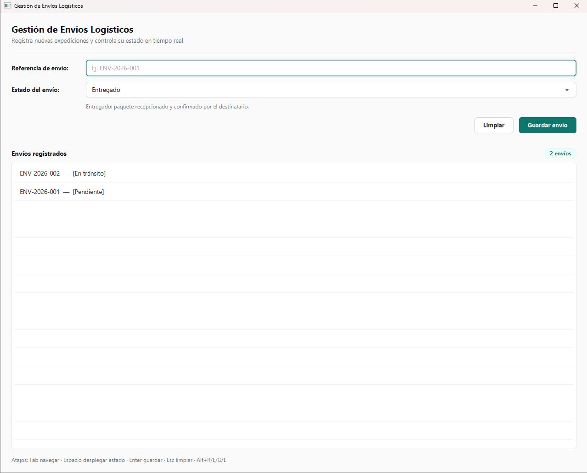

# Reto 1 - Gestion de Envios Logisticos (JavaFX, FXML y CSS)

Prototipo de aplicacion de escritorio desarrollado en **JavaFX** para el registro y control en memoria de envios logisticos. La aplicacion separa completamente la estructura de la interfaz (`vista.fxml`), el estilo visual (`styles.css`) y la logica de eventos (`Controller.java`), permitiendo modificar el diseno y el aspecto sin alterar el controlador.

## 1. Requisitos y ejecucion

- **JDK:** 25 (compatible con JavaFX 25)
- **Gestor de proyecto:** Apache Maven 3.10+
- **Dependencias principales:** `javafx-controls` y `javafx-fxml`

Para arrancar la aplicacion desde la raiz del proyecto, ejecuta:

    mvn javafx:run

## 2. Estructura del proyecto

- `pom.xml`: configuracion de Maven, dependencias de JavaFX y plugin de ejecucion.
- `README.md`: documentacion tecnica y evidencias de pruebas.
- `docs/capturas/`: capturas de pantalla de las pruebas realizadas.
- `src/main/java/com/logistica/App.java`: arranque de la aplicacion, carga de `vista.fxml` y `styles.css`.
- `src/main/java/com/logistica/Controller.java`: logica de eventos, validaciones y listado en memoria.
- `src/main/resources/com/logistica/vista.fxml`: estructura declarativa de la interfaz.
- `src/main/resources/com/logistica/styles.css`: tema visual, contraste y estados de foco.

## 3. Decisiones de diseno y usabilidad (RA 4)

- **Ventana unica y jerarquia clara:** Organizada con un contenedor raiz `VBox` dividido en cabecera, formulario (`GridPane`), botonera (`HBox`), zona de feedback y listado de envios (`ListView`) con contador dinamico.
- **Legibilidad y contraste:** Tema plano y limpio con fondo neutro (`#fafafa`), tipografia oscura (`#18181b`) y color de acento verde petroleo (`#0f766e`) para diferenciar la accion principal (*Guardar envio*) de la secundaria (*Limpiar*).
- **Feedback inmediato al usuario:** Los mensajes de confirmacion y error utilizan clases CSS diferenciadas (`.feedback-success` y `.feedback-error`) con borde lateral de acento. Los errores se ocultan automaticamente cuando el usuario comienza a corregir el formulario.
- **Control reactivo:** Un *listener* sobre el desplegable de estado (`cmbEstado`) actualiza en tiempo real la etiqueta `lblAyudaEstado` con la descripcion operativa del estado seleccionado.
- **Navegacion completa por teclado:**
  - Foco inicial automatico en el campo de referencia al abrir la ventana.
  - Orden logico de tabulacion (`Tab` y `Shift + Tab`).
  - `Espacio` despliega y cierra las opciones del `ComboBox` mediante un `EventFilter`.
  - `Enter` ejecuta *Guardar envio* (`defaultButton="true"`) y `Esc` ejecuta *Limpiar* (`cancelButton="true"`).
  - Atajos directos manteniendo `Alt`: `Alt + R` (ir a referencia), `Alt + E` (desplegar estado), `Alt + G` (guardar) y `Alt + L` (limpiar).
  - Indicador de foco visible (`:focused`) en todos los controles interactivos mediante CSS.

## 4. Jerarquia FXML y modificacion manual realizada (RA 2)

El archivo `vista.fxml` define una jerarquia declarativa encabezada por un nodo raiz `VBox` asociado a `com.logistica.Controller`, que organiza subcontenedores especializados (`GridPane` para alinear etiquetas y campos, `HBox` para barras horizontales y `ListView` con `VBox.vgrow="ALWAYS"` para aprovechar el espacio disponible al redimensionar).

### Modificaciones manuales en el archivo XML

Para demostrar la comprension de la estructura FXML y la independencia respecto a la logica de negocio, se realizaron dos modificaciones manuales directamente en `vista.fxml` sin modificar `Controller.java`:

1. Adicion de un `tooltip` al control `cmbEstado`:

    <ComboBox fx:id="cmbEstado" promptText="Selecciona un estado..." maxWidth="Infinity" GridPane.columnIndex="1" GridPane.rowIndex="1">
        <tooltip>
            <Tooltip text="Pulsa Espacio o Alt+E para desplegar los estados" />
        </tooltip>
    </ComboBox>

2. Incorporacion de una barra informativa de atajos al final del `VBox` raiz, reutilizando la clase CSS `.helper-label`:

    <Label text="Atajos: Tab navegar | Espacio desplegar estado | Enter guardar | Esc limpiar | Alt+R/E/G/L" wrapText="true" styleClass="helper-label" />

Adicionalmente, el aspecto visual completo se renovo mediante `styles.css` manteniendo intacta la logica del controlador.

## 5. Pruebas realizadas (RA 1, RA 7 y RA 8)

| # | Prueba | Accion ejecutada | Resultado obtenido |
| --- | --- | --- | --- |
| 1 | Alta correcta | Introducir `ENV-2026-001` y `ENV-2026-002`, seleccionar estado y pulsar *Guardar envio*. | Se anaden al inicio de la lista, el contador se actualiza, se muestra aviso verde y el foco vuelve a Referencia. |
| 2 | Validacion de errores | Pulsar *Guardar envio* con referencia vacia, sin estado o con referencia duplicada. | Se muestra aviso rojo indicando el error concreto y el foco se posiciona en el campo afectado. |
| 3 | Evento reactivo | Cambiar el valor seleccionado en el desplegable *Estado del envio*. | La etiqueta de ayuda inferior actualiza dinamicamente la descripcion operativa del estado. |
| 4 | Accion Limpiar | Rellenar el formulario, seleccionar un elemento de la lista y pulsar *Limpiar* (o `Esc`). | Se limpian los campos, se restablece la ayuda, se deselecciona la lista y se ocultan los avisos. |
| 5 | Uso con teclado | Operar sin raton mediante `Tab`, `Espacio`, flechas, `Enter`, `Esc` y `Alt+R/E/G/L`. | Todos los controles muestran foco visible y permiten completar el flujo sin raton. |
| 6 | Estilos CSS y redimensionado | Comprobar contraste, *hover*, *tooltips* y redimensionar la ventana. | Los estilos se aplican correctamente, la lista se adapta al tamano y se respeta el minimo de ventana. |

## 6. Evidencias visuales

### 1. Alta correcta y feedback de confirmacion

### 2. Validacion y mensaje de error

### 3. Evento reactivo al cambiar el estado

### 4. Accion Limpiar

### 5. Navegacion por teclado y foco visible

### 6. Estilos CSS, tooltip y redimensionado
